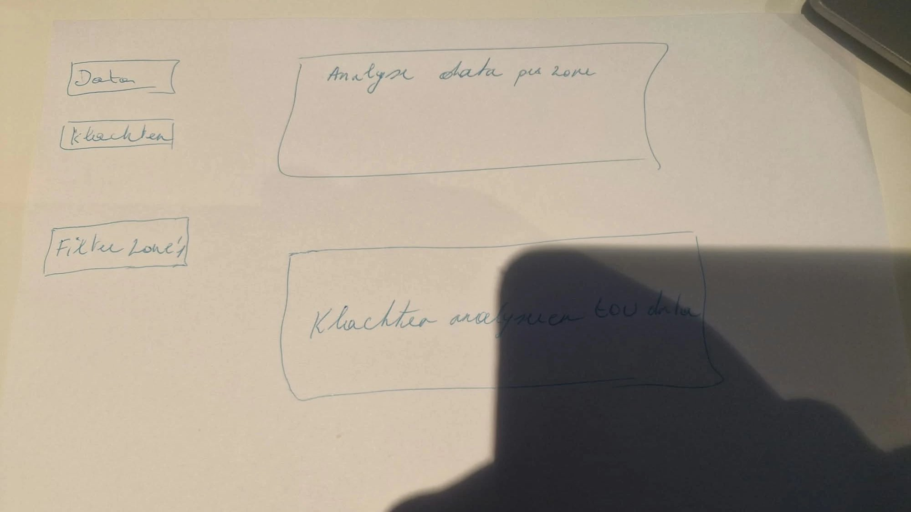

# Ontwerp – comfortapp kantoor (Project 1, stap 1)

> Werkblad volgens de vier pijlers (les 3). **✅ = ligt vast** (staat in het logboek) ·
> **💡 = voorstel van Claude, nog door jou te beslissen** · **❓ = open vraag voor jou**.
> Teken daarna de lay-out op papier en neem er een foto van (die foto lever je mee op).

**Centrale vraag:** *Zit het binnenklimaat op kantoor binnen de comfortgrenzen, en zijn de klachten gegrond?*
**Voor wie:** collega's en directie (antwoord in één oogopslag) + ikzelf (oorzaak zoeken).

---

## 1. Decompositie – de boom
Elk blad wordt een grafiek, KPI of tabel. Bladeren met ⛔ kan je **niet** uit de data halen.

```
Centrale vraag
├── A. Is het comfortabel?
│   ├── A1 % kantoorkwartieren binnen/buiten de band, per zone       → tabel, ✅ gesorteerd op % buiten band (aflopend)
│   ├── A2 Wanneer buiten de band? (zone × dag)                       → heatmap
│   ├── A3 Te koud of te warm?                                        → verdeling per zone
│   └── ⛔ gevoelstemperatuur (operatieve temp, tocht, straling)       → enkel als beperking vermelden
├── B. Zijn de klachten gegrond?
│   ├── B1 Per klacht: temp ±30 min rond het tijdstip buiten de band?  → tabel met beoordeling
│   ├── B2 Aantal klachten per beoordeling                            → KPI's
│   ├── B3 Detail van één klacht: temperatuurverloop rond het moment   → lijngrafiek
│   └── ⛔ klachten over ventilatie, akoestiek, tocht                  → "niet te beoordelen met deze data"
│                                                                     (✅ behaaglijkheid/CO2/RV = later apart dashboard)
├── C. Waarom was het buiten de band? (de "grondige reden")
│   ├── C1 Warmteproductie: aanvoer haalt het kringsetpoint niet       → lijngrafiek aanvoer vs setpoint
│   ├── C2 Setpoint/regeling: comfort- of stand-bymodus, verschuiving  → setpoint in dezelfde grafiek
│   └── ⛔ oorzaak van een datagat (lezer, netwerk)                     → enkel tonen dát er een gat is
└── D. Klopt de info? (vertrouwen)
    ├── D1 Rijen-trechter: hoeveel rijen per stap, en waarom weg       → tabel bovenaan
    ├── D2 Datagaten in kantooruren                                   → lijst
    └── D3 Zones zonder data (0.1, magazijnen) en refter = andere voeler → melding
```

## 2. Patroonherkenning – categorieën (max. 6, met indeelregel)

**Toestand per kwartier** (enkel kantooruren):
| Categorie | Regel |
|---|---|
| ✅ binnen band | ondergrens ≤ ruimtetemp ≤ bovengrens |
| ✅ te koud | ruimtetemp < ondergrens |
| ✅ te warm | ruimtetemp > bovengrens |
| ✅ geen data | geen meting in dat kwartier |

Band ✅: winter (okt–apr) 20–24 °C, zomer (mei–sep) 23–26 °C · kantooruren ✅: ma–vr 8–17 u (Belgische tijd), zonder feestdagen.

**Beoordeling per klacht:**
| Categorie | Regel |
|---|---|
| gegrond | ✅ minstens één kwartier ±30 min buiten de band, **in de richting van de klacht** (klacht "te koud" + temp te koud) |
| ongegrond | ✅ alle kwartieren ±30 min binnen de band, **of** buiten de band in de andere richting (klacht "te koud", temp te warm) |
| niet te beoordelen – geen data | datagat rond het tijdstip |
| niet te beoordelen – geen meting | zone zonder regelaar (magazijnen, 0.1) of "Andere / weet niet" |
| niet te beoordelen – ander thema | discipline ventilatie / akoestiek / … |

## 3. Abstractie – wat gebruik ik, wat laat ik weg?

| Element | Kolommen / punten | Filter | Weglaten |
|---|---|---|---|
| Comfort (A) | zone AV3 ruimtetemp | kantooruren | nacht, weekend, ✅ feestdagen (`data/feestdagen.csv`) |
| Klachten (B) | Datum, Tijdstip, Zone, Discipline, Soort klacht | geldige datum + tijd + zone | Melder, Omschrijving (niet nodig, privacy) |
| Oorzaak (C) | Priva AI12 aanvoer, AV66 kringsetpoint, zone AV1/AV2 | ±2 u rond de klacht | AV91, kraanstand (💡 later?) |
| Context | Priva AI1 buitentemp | – | – |

Detailniveau ✅: per kwartier (laatste meting, max. 1 kwartier doortrekken). Zone 1.7 ✅ via de VAV-voeler.

## 4. Algoritme – stappen van de pijplijn (`pipeline.py`, één functie per stap)

| # | Stap | Rijen weg? | Waarom |
|---|---|---|---|
| 1 | GBS-data inlezen (upload `.csv.gz`) | – | |
| 2 | Enkel de nodige punten houden | ja | andere BACnet-punten zijn niet nodig |
| 3 | Zone koppelen (`zones_koppeling.csv`) | ja | device zonder zone |
| 3b | Onmogelijke waarden weglaten (< 10 of > 35 °C) | ja | voelerfout / storing |
| 4 | UTC → Belgische tijd | – | let op winteruur 25/10 |
| 5 | Per kwartier gelijkzetten | (samenvoegen) | metingen op verschillende momenten |
| 6 | Kantooruren aanduiden | (filter in de app) | |
| 7 | Toestand per kwartier (band) | – | |
| 8 | Klachten inlezen + controleren | ja | lege datum/tijd/zone, onbekende zone |
| 9 | Klacht koppelen ±30 min + beoordelen | – | |
| 10 | Oorzaak tonen (aanvoer vs setpoint) | – | |

**Lege of rare waarden:** ✅ klacht zonder tijdstip → hele werkdag (8–17 u) bekijken. ✅ temperatuur < 10 of > 35 °C (voelerfout) → weglaten en tellen in de trechter (bv. 21/10 11:40: 3 × 0,0 °C).

## 5. Lay-out – schets (teken dit zelf op papier)

**Mijn eerste schets op papier** (`ontwerp_schets_papier.jpg`):



| Op papier | In de app |
|---|---|
| Links: **Data** · **Klachten** (uploads) | Zijbalk: 📤 GBS-data · 📤 Klachten |
| Links: **Filter zone's** | Zijbalk: filter zone(s), aangevuld met periode, band en "ook nacht/weekend" |
| Rechts boven: **Analyse data per zone** | Tab *Comfort*: A1 tabel per zone, A2 heatmap, A3 te koud/te warm + KPI's bovenaan |
| Rechts onder: **Klachten analyseren t.o.v. data** | Tab *Klachten*: B1 beoordeling per klacht, B3 verloop rond de klacht |
| – (nog niet op papier) | Tab *Oorzaak* (aanvoer vs kringsetpoint) en tab *Stap voor stap* (rijen-trechter) – toegevoegd tijdens de decompositie, uitgewerkt in `ontwerp_dashboard.svg` |

Uitgewerkte versie (Excalidraw → `ontwerp_dashboard.svg`):

```
┌─────────────────────────────────────────────────────────────┐
│ Comfort kantoor – periode [van–tot]   📤 GBS-data  📤 klachten │
├─────────────────────────────────────────────────────────────┤
│ KPI: % binnen band │ KPI: # klachten │ gegrond │ ongegrond │ n.t.b. │
├─────────────────────────────────────────────────────────────┤
│ Tab 1  Comfort    : tabel per zone (A1) + heatmap (A2)       │
│ Tab 2  Klachten   : tabel met beoordeling (B1) → klik = B3   │
│ Tab 3  Oorzaak    : aanvoer vs kringsetpoint + setpoints (C)  │
│ Tab 4  Stap voor stap: rijen-trechter + expanders per stap (D)│
└─────────────────────────────────────────────────────────────┘
Zijbalk: filter zone · periode · band aanpasbaar (min/max)
```

## Controle – hoe weet ik dat het klopt?
- Steekproef: ma 26/10 08:30, zone 1.2 → moet **gegrond (te koud)** geven, oorzaak = aanvoer 19,5 °C i.p.v. 35 °C.
- Steekproef: 15/10 10:00, zone 1.2 = 21,5 °C → binnen de band.
- % binnen band per zone narekenen in mijn Excel (`kringdata_2026-11-11_excel.xlsx`).
